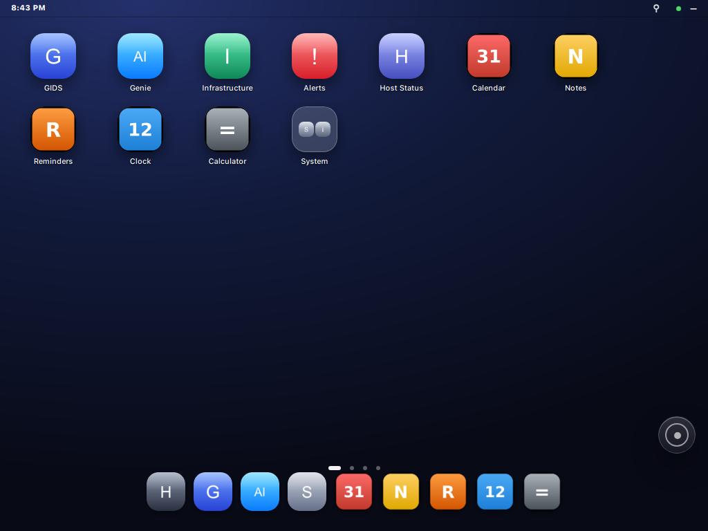
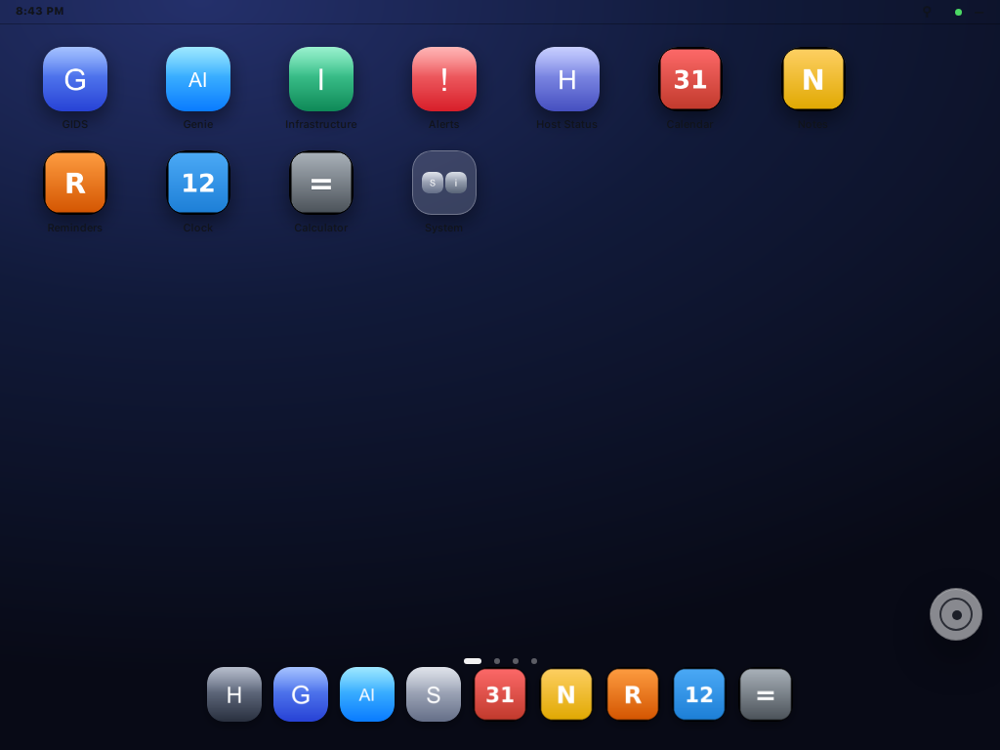
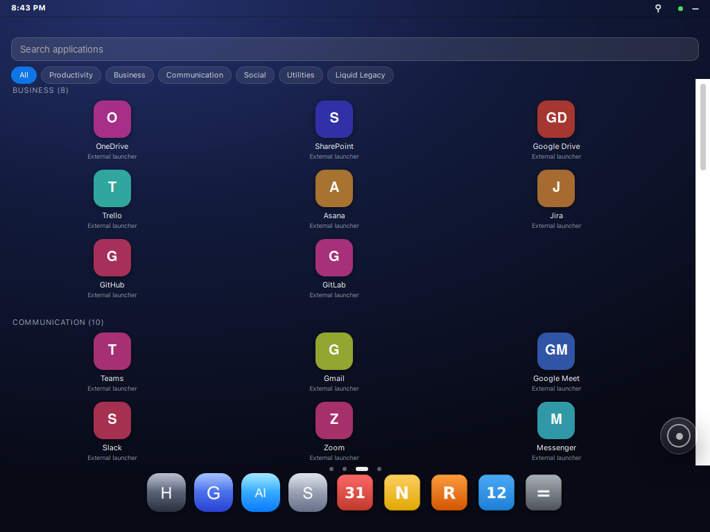
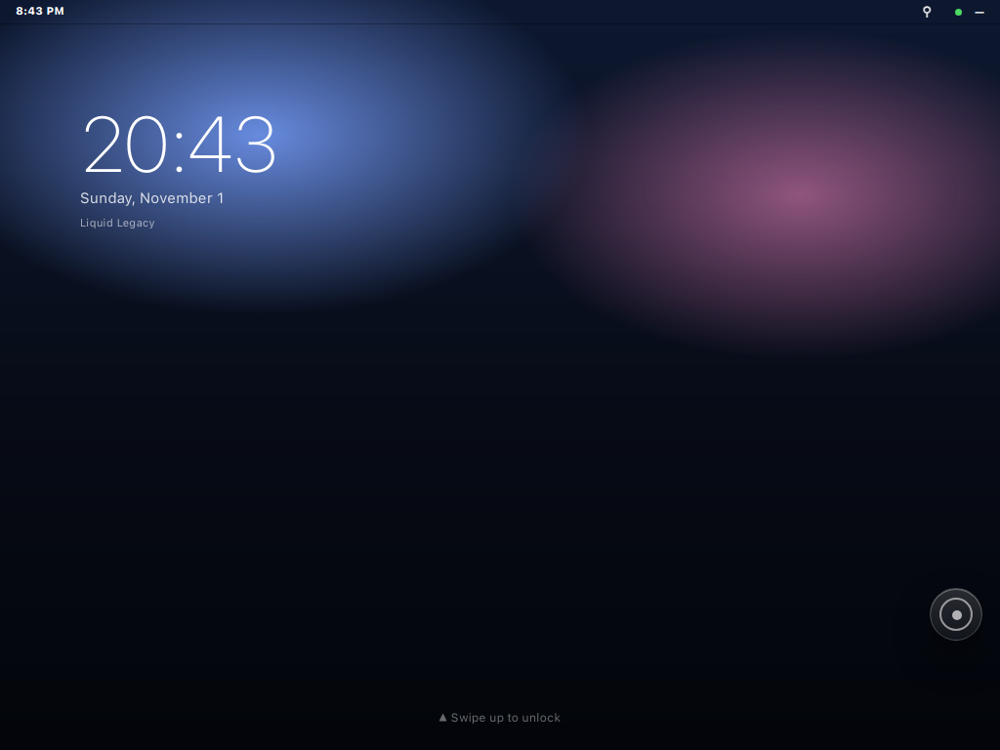
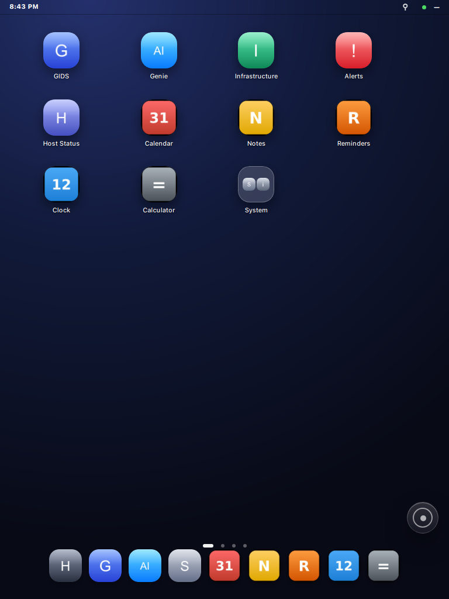

# Liquid Legacy

[](https://github.com/gidabytes/liquid-legacy/releases/latest)
[](LICENSE)
[](docs/PERFORMANCE.md)

**A Liquid Glass, iPadOS 26-inspired workspace that runs in the browser on an iPad 2 (A1395, iOS 9.3.5).**

Liquid Legacy is a vanilla ES5 web app: no framework, no build step, no service worker.
It ships with a small Python (stdlib only) companion server so it can run **standalone** on
your LAN with clearly-labelled demo data, then open it in Safari on the iPad.



## Quick start (standalone)

```bash
./run.sh                 # starts http://0.0.0.0:8090/ipad/legacy/
```

Open `http://<host-ip>:8090/ipad/legacy/` in any browser. The standalone mode:

- issues a **read-only** automatic session — no login screen;
- serves **demo data** for the system/posture/alerts/collectors widgets, marked as demo;
- keeps all personal data (notes, reminders, calendar, dock, widgets, dashboard) in the
  browser's localStorage.

## Push to the iPad 2

```bash
./deploy-ipad.sh 192.168.31.228            # IPAD_IP [HOST_IP]
```

The script prints the URL and, when SSH is available, opens it in Safari with `uiopen`.
Options:

- `GG_IPAD` — default iPad address.
- `GG_IPAD_PASS` + `sshpass` — password-based SSH (legacy ssh-rsa is negotiated).
- No SSH? Open the URL manually and use **Share → Add to Home Screen**; it launches
  full-screen because the page ships Apple web-app meta tags.

## Live backend (optional)

The companion can proxy a CyberGate backend instead of demo data:

```bash
unset GG_DEMO
export GG_UPSTREAM=http://127.0.0.1:8000
export GG_AUTO_SESSION=1 GG_AUTO_USER=... GG_AUTO_PASSWORD=...
python3 companion/gg_legacy_companion.py --host 0.0.0.0 --port 8090
```

Read-only, fixed allowlist, HttpOnly cookie; the upstream bearer token never reaches the
browser. Credentials can live in `~/.config/gg-legacy/auto.env` (mode 600) instead of the
shell.

## Install as a service

```bash
./install-service.sh      # systemd --user unit "liquid-legacy"
```

## What is inside

| Path | Purpose |
|---|---|
| `legacy/` | The app: one HTML, one CSS, one ES5 JS, local icons |
| `companion/gg_legacy_companion.py` | Static server + session + optional backend proxy |
| `run.sh` | Standalone launcher (demo mode) |
| `deploy-ipad.sh` | Open/install on the iPad |
| `install-service.sh` | systemd --user service |
| `companion/tests/` | contract tests + WebKit perf/capture probes |
| `scripts/device-bench.sh` | on-device benchmark (SSH + companion audit log) |
| `docs/PERFORMANCE.md` | device measurements and method |

## Performance (measured on a real iPad 2)

The 2.28.0 build was measured on the device itself (A5, iOS 9.3.5, Safari 9 / WebKit 601):

| Metric | before (2.27.2) | after (2.28.0) |
|---|---|---|
| warm launch, load event | 1360 ms | **91 ms** |
| warm launch -> Home painted | ~1360 ms | **284 ms** |
| static asset requests per warm launch | 15 | **0** (HTML + API only) |
| DOM nodes at boot | 592 | **358** |

How: immutable caching and gzip/ETag in the companion, `?v=` on every asset, lazy
page rendering, no hidden-widget re-render on the poll, and 128x128 8-bit icons.
Method and remaining costs: `docs/PERFORMANCE.md`.

## Screenshots

Captured from the shipped build in WebKitGTK (ephemeral profile) at the iPad's own
1024×768 / 768×1024 framebuffer sizes.

| Home · dark | Home · light |
|---|---|
|  |  |

| App Library | Lock Screen |
|---|---|
|  |  |

Portrait (768×1024):



## Tests

```bash
./companion/tests/run_tests.sh          # 31 assertions: static, cache, auth, allowlist, audit
```

The runner needs a stub upstream and starts both processes itself. Optional probes:
`companion/tests/perf-probe.py <url>` (WebKitGTK load/DOM/layout) and
`companion/tests/webkit-capture.py` (screenshot; run under `xvfb-run`).
`scripts/device-bench.sh` reproduces the on-device numbers over SSH.

## Honest limits

- Demo data is **sample data**, not live telemetry; the widgets label it as demo.
- Built-ins and launchers are simulations of an OS surface; external sites open as new tabs.
- No OAuth, no iframe embedding, no credential capture.
- iOS 9.3.5 Safari is the target: ES5 only, prefixed CSS, no modern APIs.
- Reminders, timers and alarms only fire while the page is open.

## Releases

Every tagged build is packaged as `liquid-legacy-<version>.tar.gz` on the
[releases page](https://github.com/gidabytes/liquid-legacy/releases), with the
per-version notes in [CHANGELOG.md](CHANGELOG.md).

## License

MIT — see [LICENSE](LICENSE).
